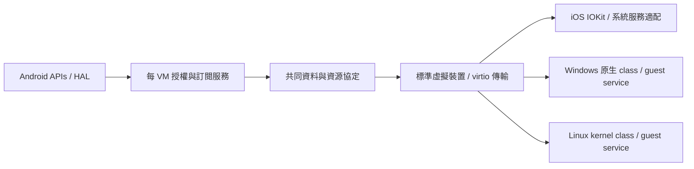

# Android host 外設 → iOS／Windows／Linux guest

調查日期：2026-10-24。目標 guest 為 iPadOS 17.7.11／21H461、iPad7,1，並考慮 Windows ARM64／x64 與 Linux。
本文件是方案與驗證清單；尚未實作新感測器、iOS 音訊或 codec provider。

## 建議架構

共用 Android 資料來源、資料格式、資源生命週期，再由各 guest 的 provider 接到原生系統 API。
線上協定不放 IOKit selector、Objective-C 物件、Apple struct 或主機指標。

優先採用已有標準的裝置模型。共同協定可承載於 virtio-console／vsock；高頻 PCM／影格使用共享 queue。
**傳輸驅動可用，只代表資料能送到 guest，不代表感測器、定位或音訊會自動出現在系統 API。**
Windows 另須確認 ARM64 驅動簽章及 PCI／ACPI 枚舉；目前 iOS 的 virtio-mmio／ADT 不能直接視為 Windows 可用。

| 功能 | 共用 host 來源 | iOS 17 原生接入候選 | Windows／Linux 路線 |
|---|---|---|---|
| 電池 | BatteryManager＋電池狀態事件 | IOPMPowerSource 子類；powerd | ACPI Control Method Battery；Linux power_supply |
| 加速度／陀螺儀／磁力計 | SensorManager | IOHID motion event provider；必要時補 SPU fastpath | HID Sensor class／Linux hid-sensor-hub → IIO |
| GPS／位置 | LocationManager 的位置／GNSS callbacks | 已存在的 locationd simulation SPI，或完整 native location provider | Windows Location／GNSS provider；Linux serial NMEA＋gpsd |
| Wi-Fi 掃描 | WifiManager 掃描快取／完成事件 | wifid／IO80211 scan provider → MobileWiFi → locationd | 專用掃描服務；需要原生 WLAN API 時另接該 OS 的 WLAN provider |
| speaker／mic | 現有 AAudio backend | IOAudio2／原映像 HAL plug-in；調查 AppleVirtIOSound | Linux virtio-snd；Windows 評估 USB Audio class 或專用驅動 |
| VPU encode／decode | Android MediaCodec／NDK codec API | VideoToolbox private provider／paravirtualization 候選 | Linux 對應媒體 driver；Windows Media Foundation 適配 |

## 目前 repo 能重用什麼

- DroidVM 已有 speaker／mic 設定與 `backend=aaudio` 的 virtio-snd 參數生成。
  位置：`DroidVM/.../CrosvmBackendInstance.java:1313` 起、`crosvm/android_audio/`、`crosvm/devices/src/virtio/snd/`。
- crosvm 有 vsock、vhost SCMI 與 virtio-console。一般 VM serial 路徑是 single-port；multiport 在 vhost-user console 路徑，
  不能直接假設現有 serial 設定已提供多埠 guest agent 通道。
- 現有電池裝置是 Goldfish，AML HID 為 `GFSH0001`，**不是** Windows 內建 `PNP0C0A` Control Method Battery。
- VPU config 目前明確未接後端。`virtio/video/` 有 ffmpeg／VAAPI／libvda 框架，未找到 Android MediaCodec guest codec backend。
  現有 MediaCodec 使用在 VNC 編解碼，不是 guest 的硬體 codec 外設。
- `android_camera` 是 Camera2 host 基礎；camera capture 與 VPU codec 是不同功能，前者也沒有完成 guest virtio-media device。

## 電池

Android 可提供百分比、是否接外部電源、充電狀態、溫度及電壓；其餘容量／電流欄位依裝置是否提供。
共同資料應分開保存百分比、實際 charge、電流、電壓及 validity，不把未知值寫成 0，也不把百分比當 mAh。
[Android BatteryManager](https://developer.android.com/reference/android/os/BatteryManager)。

iOS 最值得先做的小型 provider 是 IOPMPowerSource。XNU 的正式流程是更新 properties 後呼叫 `updateStatus()`；
目標 powerd 確有匹配 IOPMPowerSource 的字串及 IOKit notification imports。
它也有 AppleSmartBattery／AppleARMPMUPowerSource 路徑，故還需驗證只提供基類是否足夠，不能直接宣稱已有相容 ABI。
[Apple IOPMPowerSource](https://github.com/apple-oss-distributions/xnu/blob/main/iokit/IOKit/pwr_mgt/IOPMPowerSource.h)。

Windows 優先做 `PNP0C0A`、`_STA/_BIX/_BST/_BTP` 與 ACPI notify，讓內建 cmbatt.sys 消費。
Linux 透過電池 driver 對接 power_supply 的 sysfs／uevent；相同 host battery state 可同時供兩個裝置前端使用。
[Microsoft battery firmware](https://learn.microsoft.com/en-us/windows-hardware/design/component-guidelines/acpi-battery-and-power-subsystem-firmware-implementation)、
[Linux power_supply](https://docs.kernel.org/power/power_supply_class.html)。

第一個驗收：電量改變、插拔電源、充電／充滿通知，分別由 UIDevice、Windows battery API、Linux power_supply 讀到。
虛擬電池只讀 host 狀態；guest 的關機／充電控制不應成為 host 關機／硬體充電控制命令。

## IMU：陀螺儀要與加速度一起規劃

手機已實際確認有 TDK icm4x607 加速度計／陀螺儀、mmc56x3x 磁力計。Android 軸是裝置自然方向的固定座標，
不會因螢幕轉向自動交換；陀螺儀資料為 rad/s。共用 wire 使用明確 SI 單位、host timestamp、sequence、accuracy 及座標轉換矩陣。
[Android sensor coordinates](https://developer.android.com/develop/sensors-and-location/sensors/sensors_overview)、
[Android motion sensors](https://developer.android.com/develop/sensors-and-location/sensors/sensors_motion)。

Windows 內建 HID Sensor class 支援 accelerometer、gyro 等 11 類，GPS 不在該清單。Linux HID sensor hub 解析報告後，
仍需對應 sensor processing driver 才有 IIO 介面。可先規劃標準 HID sensor descriptors，再選虛擬 USB HID 或 guest 端 HID provider。
現有 virtio-input 的 evdev touch／keyboard 封包不等於 HID sensor class。
[Microsoft HID Sensors](https://learn.microsoft.com/en-us/windows-hardware/drivers/hid/sensor-hid-class-driver)、
[Linux HID sensors](https://docs.kernel.org/hid/hid-sensor.html)。

iOS 目標 locationd 有 IOHIDEventSystemClient、IOHIDServiceClientFastPath、AppleSPUHIDDevice／SPU fastpath 的直接證據。
先驗證一般 HID motion events 能否到 CMMotionManager 的 raw accelerometer／gyro；若 raw 可用而 batching／deviceMotion 不可用，
再處理 SPU fastpath／fusion，不能把「鍵盤觸控已成功」當作 motion ABI 已完成。
Apple OSS 有 accelerometer／gyro event constructor，但其 layout／IOFixed 單位仍需對照 21H461。
[Apple IOHIDEvent source](https://github.com/apple-oss-distributions/IOHIDFamily/blob/main/IOHIDFamily/IOHIDEvent.cpp)。

初始取樣建議 50–100 Hz，按 guest 訂閱調整，批次傳輸並合併通知。須測靜止重力、三軸正負旋轉、顯示旋轉、pause/resume、
掉樣與時間軸；raw gyro 正確不代表 fused attitude／heading 正確。

## GPS 與 Wi-Fi 定位

位置資料優先轉送 Android 已算出的 fix：經緯度、altitude、速度／航向、各自 accuracy、fix 時間與有效期。
GNSS raw measurements／NMEA 可為另外的 capability；不要把 fused fix 冒稱成衛星原始測量。
過期 last-known location 必須標 age／invalid，guest 不能把它當成現在的位置。
[Android LocationManager](https://developer.android.com/reference/android/location/LocationManager)。

iOS 21H461 的 launchd MachServices **確有** `com.apple.locationd.simulation`，locationd binary 有 simulation protocol 與 location struct 字串。
這是最小可行性探針的優先候選，屬私有 SPI，尚未驗證 client entitlement、XPC interface 或 CLLocationManager delivery。
它可能將資料標成 simulated，應保留正確來源標記。完整模擬 GNSS／baseband 的工作量大得多。
另須注意目前 board bootargs **停用了 locationd**；做功能驗證前需以受控方式重新啟用並檢查啟動依賴。

Linux 的 NMEA 串流可交給 gpsd；Windows 需要 Location／GNSS provider，不能因為 HID sensor class 可用就推論 GPS 也自動可用。
[gpsd](https://gpsd.io/gpsd.html)、[Microsoft sensors platform](https://learn.microsoft.com/en-us/windows-hardware/drivers/sensors/)。

Wi-Fi 保持使用者指定的掃描專用能力：SSID 原始 bytes、BSSID、RSSI、frequency/channel、security flags、scan timestamp／完成狀態；
不提供 association、密碼設定或資料面。BSSID 是 AP 的位址，不是手機自身的 MAC；不改 host 的 MAC 或 Wi-Fi 連線。
優先被動接收現成掃描結果，另支援低頻 request-scan。Android 有權限與掃描節流，常規前景限制為 2 分鐘 4 次；
背景限制更嚴，資料也可能是快取。定位用途需要正確的 location permission，不能用 neverForLocation 宣告替代。
[Android Wi-Fi scanning](https://developer.android.com/develop/connectivity/wifi/wifi-scan)。

目標 wifid imports `Apple80211ScanAsync`／Open／Get，允許 `IO80211APIUserClient`；locationd 使用 MobileWiFi 的 scan／cache callbacks。
因此只在 guest app 顯示一份 SSID 表，不會自動改善原生定位。要讓原生 locationd 消費，必須接 IO80211／MobileWiFi 的掃描 provider，
含匹配 properties、非同步完成事件與結果字典。Settings 是否能正常呈現「只掃描、不能連線」亦須實測。
Windows/Linux 若要求原生 WLAN scan API，同樣要接 OS 的 WLAN provider；通用 guest agent 的 AP 清單只解決資料通道。

## Speaker／mic

先重用現有 virtio-snd＋Android AAudio。Linux 可使用 `CONFIG_SND_VIRTIO`；upstream virtio-win 的 driver 清單目前沒有 sound driver，
不能承諾 Windows 裝完 virtio-win 就有聲音。Windows 若優先考慮內建 driver，另做 USB Audio class 前端是可研究路線，
底下仍共用同一 PCM backend；需補虛擬 USB device，現有 Android AAudio 不是 USB Audio emulation。
[QEMU virtio-snd](https://www.qemu.org/docs/master/system/devices/virtio/virtio-snd.html)、
[virtio-win repository](https://github.com/virtio-win/kvm-guest-drivers-windows)。

iOS 原映像確有 `BuiltinAudioPlugin.driver`、`AppleUSBAudio.driver`、AudioServerPlugIn factory／IO-cycle interface，
並有 IOAudio2DeviceUserClient transport。audiomxd entitlement 另列 AppleVirtIOSoundUserClient，但 entitlement 只是許可名單，
不證明裝置 driver 已存在或可用。優先細讀原 target HAL／IOAudio2 邊界，再決定自製 HAL plug-in 或 kernel provider。
也要確認該開機實際由 audiomxd 還是 mediaserverd 掌管音訊。

AudioDriverKit 支援的 iPadOS 裝置是 M 系列 iPad，不能用它替代本專案 A10X／iPad7,1 的 iOS 17 接入工作。
[Apple AudioDriverKit](https://developer.apple.com/documentation/audiodriverkit)。

第一階段固定 48 kHz stereo playback／mono capture，雙向共享 PCM ring，帶 frame counter、host timestamp、format 與 stream generation。
測 AudioUnit RemoteIO、AVAudioSession route、underrun、overrun、停止／恢復、裝置切換及 input permission。
音訊時鐘由 frame position 校準，不能靠每個 buffer 的到達時間推算；必要時重採樣以吸收 host／guest 時鐘差。
mic 另需核對 Android 版本的 foreground-service／錄音授權與 UID attribution，不能只看 app manifest 有 RECORD_AUDIO。

## VPU：系統 codec 接入與資源生命週期是主要工作

Android 端需要新增 MediaCodec backend，並實測裝置 codec capabilities。crosvm 現有 virtio-video 框架與 guest driver 版本需匹配，
不要把 experimental virtio-video 與後續 virtio-media 的協定混用，也不假設所有 Linux distro 有內建 driver。
Windows 的原生接入可調查 Media Foundation／MFT provider；iOS 則需接 VideoToolbox 的系統 provider 邊界。

21H461 原映像有 `VideoToolboxParavirtualizationSupport.framework`，audiomxd 的例外名單列
`AppleVideoToolboxParavirtualizationUserClient`。先查這個虛擬化邊界，比直接重做 AppleAVE／AppleAVD 更值得做小型探針。
目前沒有取得其 selector、buffer 與 factory ABI，尚不能承諾可用。

`VTCompressionSession`／`VTDecompressionSession` 是使用既有 codec 的 API；
`VTRegisterSupplementalVideoDecoderIfAvailable` 也只是註冊系統已有的 decoder。
Apple MediaExtension 自訂 decoder 的官方範例目標是 macOS 15，不能當成 iOS 17 的公開擴充機制。
[Apple supplemental decoder](https://developer.apple.com/documentation/videotoolbox/vtregistersupplementalvideodecoderifavailable(_:))、
[Apple MediaExtension sample](https://developer.apple.com/documentation/mediaextension/supporting-custom-media-formats-and-decoders)。

共用協定至少包含 codec/profile/level、bitstream、PTS/DTS、EOS/drain/flush/reset、frame generation、crop/color/HDR metadata，
以及平面 offset／stride／format／modifier。用 resource ID 引用共享 buffer，不傳 host fd／指標或假定 Android AHB 就是 IOSurface。
可先做有界 copy 版本驗證 ABI，再依實測改為 host codec Surface／AHB → GPU copy → guest IOSurface；零拷貝需逐格式證明，
不能先保證 MediaCodec 可直接寫 guest SG pages。

buffer 要在真正 producer／consumer completion 後才重用；reset 需讓舊 generation 失效。不要用任意逾時當作成功完成。
這與本次畫面閃爍暴露的生命週期問題相同。

驗收先用固定 H.264 clips，檢查 iOS `UsingHardwareAcceleratedVideoDecoder`／encoder 對應 property，
並要求 hardware decode/encode，避免只測到軟體 fallback。Decode 比對原始像素／順序／時間戳；encoder 因有損及合法多種輸出，
用解碼後品質、幀數、時間戳與設定符合性驗證，不要求 bitstream byte-identical。

## 共同協定與實作順序

1. 定義 version/capabilities、request ID、payload length 上限、resource generation、status／未知值。
   分開低頻 state、IMU batch、PCM ring、codec resource queues，避免共用一把鎖讓 codec／GPU 拖住所有外設。
2. Android app UID 的 host service 管 permission／訂閱／前背景生命週期，daemon/VMM 管每 VM routing。
   Linux/Windows agent 通道可優先使用現有 virtio serial／vsock，iOS補對應 driver；匯流排枚舉另行驗證。
3. 電池 → raw accel/gyro → GPS fix：先讓三種 guest 的原生 consumer 各通一個最小測例。
4. speaker/mic：重用已存在的 host backend，完成 iOS route／PCM／時鐘驗證。
5. scan-only Wi-Fi：先確認各 OS 原生定位 consumer 真正收到掃描資料，再考慮 Settings 表現。
6. VPU：先驗證一個 codec／格式的系統接入及 buffer 回收，再擴充格式與加速路徑。

Windows ARM64 的 vioserial/viosock 目前有 upstream build/package 清單，但特定發行版簽章與實機枚舉仍需檢查，
不能把 source 能編譯視作已交付可用驅動。
[virtio-win ARM64 package inputs](https://github.com/virtio-win/kvm-guest-drivers-windows/blob/master/win11_arm64.ddf)。

本次 iOS 直接證據來自使用者現有 21H461 映像的 daemon imports、embedded entitlements、plist 與字串；
SystemOS shared cache 當時未掛載，尚未完成相關 private-framework ABI／呼叫時序分析。
粗篩原始筆記在 `/tmp/droidvm-{ios-device-triage,host-devices-evidence,media-devices-evidence}.txt`；上述候選皆須通過最小 probe 後才升級為已驗證接口。
