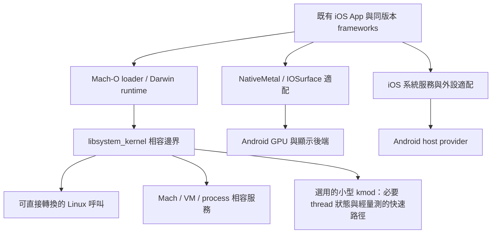

# iOS subsystem for Android：可行性與缺口

評估日期：2026-10-24。範圍是讓既有 iOS ARM64 程式在 Android/Linux 上執行，不是把有原始碼的 App 改寫成 Android App。第一階段建議固定目前 iPad7,1／iPadOS 17.7.11（21H461）的 runtime，使用自編、可直接執行的測試程式；App Store／Apple 帳號服務不列為初期目標。arm64e 支援須另行驗證，不能由 kernel 的 arm64 slice 推定每個 userspace binary 的 subtype。

這是架構評估，尚未實作 subsystem，也未修改正在運行的 VM。下文把原始碼事實、已有專案先例和本案建議分開。

## 判斷

**有可行的研究路線，但「GKI kmod 模仿 syscall」只解決其中一層。建議採混合方案：保留同版本 iOS frameworks，替換或修改最低層 runtime，建立 Darwin/Mach 相容服務，再接 Android 後端。**

XNU 原始碼讓 Mach IPC、VM、thread、BSD ABI 有可查的實作，也能抽取部分程式碼移植；它不會自動補出 UIKit 背後的私有服務、IOKit 裝置協定與 Apple 執行環境。把 XNU syscall 函式搬進 Linux，也仍要替換其 task、thread、vm_map、vnode、waitq、lock、allocator 等依賴。

Darling 提供直接先例：它使用修改過的 libsystem_kernel，把部分操作送進 userspace 的 darlingserver，後者保留部分 XNU 實作。Darling 曾用 kernel module，後來因穩定性與除錯成本改成 userspace。這證明 XNU 語意不必全部放在 Linux 核心，但並不證明現代 iOS 可直接由 Darling 執行。[Darling syscall emulation](https://docs.darlinghq.org/internals/basics/system-call-emulation.html)、[darlingserver](https://docs.darlinghq.org/internals/darlingserver/index.html)。

| 目標 | 本案可行性判斷 | 最主要的前置工作 |
|---|---|---|
| ARM64 Mach-O CLI／自編測試 | 合理的第一個 PoC | loader、trap、TLS、基本 VM／檔案 ABI |
| 原版 Foundation／libdispatch 程式 | 可研究，但已超出 syscall 編號轉換 | dyld cache、thread/workqueue、Mach/XPC、基礎服務 |
| 固定版本 UIKit／Metal App | 有價值的中期目標，缺口大 | 私有 UI 服務、IOSurface、合成與輸入、裝置後端 |
| 現代 iOS App 廣泛相容 | 長期平台工程 | frameworks／服務版本覆蓋、WebKit 多程序、媒體與安全語意 |
| 完整 SpringBoard 系統替代目前 VM | 現階段投入效益較差 | 幾乎整套 Darwin 執行環境與 iOS 系統服務 |

以上是工程判斷，不是已測得的相容率或時程。現有 VM 應繼續作為功能與語意的對照環境。

## kmod 的邊界：除了 syscall，還有什麼？

### 1. ARM64 trap ABI 不同

本機 XNU `libsyscall/custom/SYS.h:451` 的 wrapper 把 syscall number 放在 **x16**，執行 `svc`，並用 carry flag 判斷錯誤。Linux GKI 6.6 `arch/arm64/kernel/syscall.c:151` 則從 **x8** 取號碼。不能直接讓 Darwin 的 SVC 落進原 Linux dispatcher，再期待只有 ENOSYS；x8 可能剛好是有效的 Linux syscall number。

需要明確的 Darwin execution personality、參數／結構與 errno 轉換，還要處理 restart、signal、取消點和兩種 ABI 交界。單純覆寫一張 syscall table 不足。

候選入口：

- 重建或 patch libsystem_kernel 的 syscall wrappers，讓常見呼叫直接走相容層。
- 同時處理 dyld 的早期 syscall；它有靜態連結的底層 runtime，不能只換一個 dylib 就涵蓋全部入口。[Darling loader](https://docs.darlinghq.org/internals/basics/loader.html)。
- 對 inline SVC，先用明確受控的 seccomp/SIGSYS 或 ptrace 原型取證，之後評估 loader rewrite 或核心入口。`SECCOMP_RET_TRAP` 可阻止原 syscall 並交回 signal handler；它只是攔截機制，不會自動補出 Darwin ABI。[Linux seccomp](https://www.kernel.org/doc/html/v6.6/userspace-api/seccomp_filter.html)。
- 不把 Syscall User Dispatch 當成本機既有能力：這份 GKI 6.6 的實作由 `CONFIG_GENERIC_ENTRY` 控制；ARM64 使用自己的 entry 路徑，未接入該功能。其他 kernel 必須逐版查實作／實測，不能從通用 API 文件推論支援。[Linux SUD](https://www.kernel.org/doc/html/v6.6/admin-guide/syscall-user-dispatch.html)。

### 2. TLS 有不經 syscall 的直接讀取

XNU `libsyscall/os/tsd.h:149` 的 ARM64 `_os_tsd_get_base()` 直接讀 **TPIDRRO_EL0**。GKI 6.6 `arch/arm64/kernel/process.c:429` 對一般 ARM64 thread 切換會把該 register 清零，Linux TLS 則由 TPIDR_EL0 提供。

因此只攔 SVC 仍會讓既有 pthread／runtime 的直接 TSD 讀取失敗。兩條候選路線是：

- 核心在 Darwin thread 的 context switch／返回 userspace 時正確保存、恢復該狀態；需要核對 hook 時機及 signal／clone／exec 路徑。
- 載入器或 runtime 重建改寫 TSD 存取；但 inline 到其他 binary 裡的版本也要涵蓋。

這是 kmod 可能有實際價值的地方。還要讓 Android/Bionic 與 Darwin 的 TLS、callbacks、signal handlers 在交界正確共存。一次 ioctl 設好 register 不代表下一次 thread switch 後仍然有效。

### 3. Mach 是有狀態的核心物件模型

XNU `osfmk/kern/syscall_sw.c:122` 起可見 task/thread self、port 操作、message、semaphore、mach_msg2 等 traps。`ipc_port.h` 另有 send/send-once/receive rights、no-senders/dead-name notifications、guard 與引用計數。

可用 Unix sockets、fd、共享記憶體當底層工具，但必須另實作 Mach 名稱空間、權利轉移、OOL memory、程序結束時的失效與通知，以及 audit trailer。把 port 當整數 fd、把 mach_msg 當普通 sendmsg，並不能滿足 libxpc／系統服務的語意。

Darling 的做法是移植 XNU 部分程式，將鎖、thread、等待、timer 等依賴接到自己的執行環境；不是直接編譯整個 XNU。[Duct-taped code](https://docs.darlinghq.org/internals/darlingserver/duct-tape.html)。本案可先評估該核心與 iOS 17 ABI 的差距。

### 4. VM、commpage、thread/workqueue 要一致

| 面向 | 必須補的語意 |
|---|---|
| dyld／Mach-O | segment mapping、ASLR、fixups、shared cache/subcaches、啟動參數、early runtime |
| Mach VM | memory entry、共享／COW、map/protect/remap、purgable 狀態與物件生命週期 |
| commpage | 固定位址資料、page size、CPU features、timebase、時鐘等直接讀取 |
| pthread／dispatch | bsdthread 註冊與入口、workqueue upcall、ulock、取消、優先級／QoS 相關行為 |
| event／exception | kqueue 的 Mach/workloop 語意、signal frame、Mach exception delivery |
| 檔案／程序 | Darwin stat/flags/xattr、路徑與容器、spawn attrs、fd 繼承、進程回收 |

現在 UniXNU 自己已有 `native-4k-user-abi.patch`，同時修改 Mach-O map、shared region 和 commpage 宣告的 page size；這正是「一般 mmap 可用」仍不等於 Darwin VM ABI 完整的實例。Subsystem 也須固定並驗證 4 KiB／16 KiB 行為，而不能只改 `getpagesize()`。

開源 XNU 也不等於所有 iOS 裝置實作都有原始碼。原版 IOKit userspace 所呼叫的私有 user-client selectors、IOSurface 與顯示協定，仍須以公開介面、已有驅動和實際行為補齊。第一個 PoC 不需要先移植 APFS：可把所需 runtime 檔案放在 Linux 檔案系統，先接好 App 可觀察的路徑、metadata、權限與共享映射語意。

### 5. GKI 不是任意核心擴充 API

GKI 的穩定 KMI 只涵蓋指定 Android/LTS 組合及 symbol list。vendor module 不能把任意未匯出的 entry/scheduler/mm 內部函式當成穩定介面。[AOSP stable KMI](https://source.android.com/docs/core/architecture/kernel/stable-kmi)。

在我們可載入自訂模組的開發機上，使用版本限定的 hooks／patch 是可研究的；代價是每版重新驗證。**「這台手機可載入模組」和「可跨 GKI 通用部署」是不同里程碑。** 若需要調整 kernel entry/context switch，應明確記為核心相容性依賴，不把它隱藏在一般 driver 的名稱下。

## userspace 應該抽取，還是重做？

| 路線 | 收益 | 主要成本 | 本案取捨 |
|---|---|---|---|
| 原版 userspace 幾乎不動，全部由 kmod 承接 | 最大程度保留同版本私有 ABI | Linux 內需要很廣的 XNU personality；仍有裝置與服務缺口 | 可作研究，但不選為第一版完整架構 |
| 重做 libSystem 到 UIKit／系統 frameworks | 可逐步減少原版 runtime 依賴 | API、ObjC/Swift ABI、UI 行為、私有 SPI 與服務協定都成為自己的工作 | 適合固定少量 App 或舊系統，不適合初期廣泛 iOS 17 相容 |
| 同版本 frameworks＋替換底層 runtime／服務適配 | 保留高階行為，集中處理 OS 邊界 | loader/cache、Mach、TLS、服務仍必須做對 | **建議路線** |

touchHLE 是高階重實作的實際例子，但目前公開範圍集中於早期 32-bit iOS 遊戲，不能當成完整重寫現代 UIKit 成本很低的證據。[touchHLE FAQ](https://touchhle.org/faq.html)。

建議的元件切分：

| 元件 | 第一階段策略 |
|---|---|
| Mach-O loader、dyld、libsystem_kernel | 自有 loader；匹配版本的 dyld／底層 library 重建或可重現 patch；涵蓋 early syscalls |
| objc、Swift、libc、libpthread、libdispatch | 優先保留版本一致性；有合適開源版本才重建，逐一接好 kernel-facing ABI |
| Foundation、UIKitCore、QuartzCore、CoreText、資源 | 保留同一份 runtime 的依賴集合，避免任意拼接不同 iOS 版本 |
| bootstrap／launchd 介面、notifyd、cfprefsd、securityd 等 | 根據實際依賴決定保留服務或實作協定；每個保留的服務都要納入其下游依賴 |
| FrontBoard／RunningBoard／BackBoard 與合成服務 | 第一個 UIKit App 就要調查；不是有 UIKit dylib 即可忽略的背景元件 |
| IOKit／IOSurface | 實作 App/frameworks 所見的 matching、user-client、memory/port 介面；後端改走 Linux 資源 |
| Metal | 重用 NativeMetal／metal2vulkan，新增 Android Vulkan／KGSL 後端與呈現整合 |
| 音訊、定位、感測器、媒體 | 沿用共同 host provider 設計，改由 subsystem service 連 Android API |

「抽取」建議以可重現、版本固定的 **runtime bundle** 為單位，保留 cache/subcache UUID、dyld、必要服務與資源；不是把幾個 UIKit/Foundation dylib 複製到 Android 就結束。第一版可先保留整份 cache 的檔案映射，由 demand paging 按需載入，待功能穩定後再縮減依賴。實際 sharing/PSS 必須量測。

「重做 lib」主要應發生在 **OS 邊界**。不能直接拿 Bionic libc 當 libSystem：除 binary format、資料結構與 TLS 外，Apple ARM64 的可變參數及部分 C++ calling convention 也和通用 ABI 不同。跨 Mach-O／ELF 使用明確的、非 variadic C/POD 介面與 callback 規則。[Apple ARM64 ABI](https://developer.apple.com/documentation/xcode/writing-arm64-code-for-apple-platforms)、[Darling ELF bridge](https://docs.darlinghq.org/internals/calling-host-system-apis.html)。

arm64e/PAC 應另設階段：CPU 支援 PAC 不等於 Apple ABI、authenticated fixups 和跨程序 shared-cache keys 已一致。Linux 本身有 PAC keys 與啟用控制，故也不能簡化成「非 Apple CPU 不可能執行」。[Linux pointer authentication](https://docs.kernel.org/arch/arm64/pointer-authentication.html)。

## 建議架構

初期避免所有 BSD 呼叫都繞 server：可在 client 正確轉換的檔案／記憶體操作直接執行；Mach 全域物件與跨程序操作交由服務管理。kmod 優先處理真正需要的 thread 狀態或已證實的共享記憶體／同步瓶頸，而不是先移植完整 XNU VM/VFS。

若原版 TSD 存取迫使我們使用 kernel context-switch 支援，仍可採 userspace Mach server；兩者並不互斥。相反地，若 loader/runtime 能完整解決 TLS，就可先把 kmod 降到零，再由 profiling 決定是否加入。

安全身份也是相容性需求：csops、entitlements、audit token、sandbox/container 會影響系統服務是否接受請求。不能統一回傳成功來掩蓋缺口；不同 App 的身份和權利必須一致，Android 端資源授權則由可信 host service 控制。原 Apple kext／AMFI binary 也不能直接作為 Linux module 載入。

## 能重用目前 DroidVM 的哪些成果？

- **直接有價值：** ARM64 iOS runtime 版本研究、私有 UI/IOKit ABI 證據、Metal frontend、AIR→SPIR-V 與 Vulkan runtime、正確性測項、視覺取證方法、Android 顯示與外設後端經驗。
- **需改後端：** IOSurface 記憶體與 port 管理、Turnip 的 Darwin KMD、present／fence 交接、Mach-O 到 Android ELF 的 GPU 呼叫邊界。
- **不能直接搬：** 依賴 IOService、IOUserClient、IOMemoryDescriptor、XNU task/pmap 的驅動。它們提供已知行為與測試，但不會因為同是 C++ 就變成 GKI module。

目前 [PROGRESS.md](../PROGRESS.md) 的20:45更新記錄31項 MetalCheck CLI 通過，旋轉後回桌面的舊畫面已通過該次視覺情境，文字破圖仍未解。這些是 VM 的證據，不是 subsystem 成果。既有 VM 不僅是退路，也適合成為 Linux 相容層的 differential oracle。

## 效能判斷

**不能預設 subsystem 一定比目前 VM 快。** 目前同 ISA 的 VM 已讓大部分 App ARM64 指令直接在 CPU 執行，並不是逐指令模擬。移除 VM 的可能收益是記憶體與 Android 更直接整合、減少部分裝置代理／退出成本，而不是消除全部 CPU 執行開銷。

Subsystem 可能新增每次 Mach RPC 的 context switch、資料拷貝、signal trampoline，以及兩種 TLS/ABI 交界。保留大量 iOS 服務時，其背景成本也不會自動消失。

GPU 的重要路徑應使用持續存在的共享 buffer、批次命令與明確 lifetime；不要把每個 draw/dispatch 都做成同步跨程序 RPC。IOSurface→dma-buf/AHardwareBuffer 的零拷貝需要驗證格式、stride、cache coherence、producer/release fence，不能由共享 fd 推定正確；同樣不能靠到處增加全域 fence 掩蓋相依問題。

效能驗收應比較相同 App／場景的 PSS（含共享 cache 與服務）、CPU time、啟動時間、Mach IPC p50/p95、frame time／掉幀、GPU throughput 與功耗。以相同熱狀態與負載控制比較 VM 和 subsystem，不能用單次 Hello World 或純算術 benchmark 決策。

## 建議的驗證順序與停止條件

1. **固定 ABI，完成最小 loader/TLS PoC。** 檢查實際 Mach-O/cache subtype；執行 write/exit/mmap，測正常及錯誤回傳。測雙執行緒 TSD、yield/context switch、signal 中斷及返回。先證明 Darwin 與 Android ABI 能共存。
2. **打通原版 runtime。** 在不啟動桌面的情況下跑 ObjC/Foundation、pthread、dispatch、timer；再驗證 Mach right transfer、dead-name、OOL memory、XPC round-trip 和程序死亡清理。以原 VM 對照輸出與事件順序。
3. **把 MetalCheck CLI 移到 subsystem。** 重用目前31項 oracle；先以相同 metallib 測正確性，再量測 performance。專門檢驗 IOSurface、no-copy CPU→GPU、一個 buffer 被多程序共享、旋轉和 fence。
4. **一個真正的 UIKit App。** 包含文字、scroll/animation、鍵盤、前後景；列出實際必要服務。既驗 app backing store，也驗最後合成幀。不能只以 launch 成功或無 GPU loss 作為通過。
5. **再決定擴張。** 首個 UIKit App 如果需要引入幾乎全部 SpringBoard 服務，重新比較「維持 VM、改善 Android 整合」的成本；若相容層可保持小而完整，再擴展 WebKit、多 App 與外設。

第一個值得做的產物是 **Mach-O＋TLS＋Mach IPC 的小型 ABI 測試床**。這三項過關後再投資原版 frameworks 的整包移植；初期不承諾整個 iOS desktop，也不以完整重寫 UIKit 作為預設方向。

## 本機原始碼證據

核對版本：XNU reference `d8b8029`（xnu-10063.141.1）；本機 GKI 6.6 reference `9ca8b2da8`。這是 source review，沒有在目前手機上驗證新 syscall hook。

| 原始碼 | 位置與證據 |
|---|---|
| XNU `libsyscall/custom/SYS.h` | 451起：x16、SVC、carry error return |
| XNU `libsyscall/os/tsd.h` | 149起：TPIDRRO_EL0 直接 TSD 讀取 |
| XNU `osfmk/kern/syscall_sw.c` | 122起：Mach ports、messages、semaphore、mach_msg2 |
| XNU `osfmk/ipc/ipc_port.h` | 144、200、600、614、668附近：rights及death/no-senders語意 |
| XNU `bsd/kern/syscalls.master` | 541起：bsdthread/workq；818起：ulock；848：shared_region_map_and_slide_2_np |
| XNU `osfmk/arm/commpage/commpage.c` | 142起：commpage內容與page size |
| UniXNU `patches/xnu/native-4k-user-abi.patch` | Mach-O／shared region／commpage一致修改 |
| GKI `arch/arm64/kernel/syscall.c` | 151：Linux syscall number取x8 |
| GKI `arch/arm64/kernel/process.c` | 429：一般ARM64 thread清TPIDRRO_EL0，恢復TPIDR_EL0 |
| GKI `include/linux/syscall_user_dispatch.h` | CONFIG_GENERIC_ENTRY gate；未啟用時返回EINVAL |
| NativeMetal `NativeOfflineGPU.cpp` | IOUserClient／task-local port依賴，須換Linux後端 |

引用的原始碼：XNU（apple-oss-distributions/xnu）、Android GKI 6.6.118（2026-02）、UniXNU（UniXNU/UniXNU）。上列外部引用均為專案或平台官方文件。
